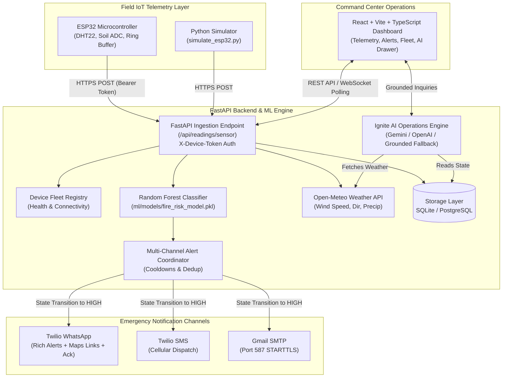

# 🔥 Ignite Shield: Autonomous Wildfire Early Warning & Telemetry System

Ignite Shield is a production-grade, IoT-driven wildfire detection, telemetry analysis, and incident coordination platform designed for forest departments and emergency response teams.

The system combines on-site ESP32 microcontrollers, a FastAPI backend with Scikit-Learn Random Forest fire risk inference, Open-Meteo live weather data, multi-channel dispatch alerts (Twilio WhatsApp, Twilio SMS, and Gmail SMTP), an AI operations assistant grounded in live sensor telemetry, and a React Vite operations dashboard.

---

## 🏛️ System Architecture



---

## 🚀 Quick Start (Local Development)

### 1. Prerequisites
- **Python**: 3.10+ (tested through 3.14)
- **Node.js**: 18+ and `npm`
- **Docker & Docker Compose** (optional, for containerized run)

### 2. Backend Setup
```bash
# Clone and checkout the feature branch
git clone https://github.com/kamalakar-123/ignite_shield_new.git
cd ignite_shield_new
git checkout feature/production-integration

# Set up Python virtual environment
python3 -m venv .venv
source .venv/bin/activate

# Install backend dependencies
pip install -r backend/requirements.txt

# Configure environment variables
cp backend/.env.example backend/.env

# Start FastAPI backend (Default uses SQLite: zero-config, no Postgres setup needed!)
PYTHONPATH=backend uvicorn main:app --reload --host 127.0.0.1 --port 8000
```
- API Swagger Documentation: `http://localhost:8000/docs`
- Backend Health Check: `http://localhost:8000/health`

### 3. Frontend Setup
```bash
# In a new terminal window:
cd frontend
npm install
cp .env.example .env
npm run dev
```
- Operations Dashboard: `http://localhost:5173`

---

## 📡 IoT Device Integration & ESP32 Firmware

### 1. Hardware Pinout
| Component | ESP32 GPIO Pin | Description |
|---|---|---|
| **DHT22** (Temp & Humidity) | `GPIO 4` | Digital 1-Wire temperature & relative humidity |
| **Capacitive Soil Moisture** | `GPIO 34` (ADC1_CH6) | Analog soil moisture percentage |
| **Status LED (Network/Sync)** | `GPIO 2` (Onboard) | Solid = Connected; Blinking = Reconnecting |
| **Alarm LED / Buzzer** | `GPIO 15` | Triggers locally if critical fire threshold reached |

### 2. Microcontroller Firmware (`esp32/ignite_shield_esp32/ignite_shield_esp32.ino`)
- **Station Coordinates**: Embedded GPS coordinates (WGS-84) for fixed towers without dedicated GNSS hardware.
- **Physical Sanity Validation**: Drops corrupted ADC readings (-20°C to 100°C, 0-100% bounds).
- **Offline Ring Buffer**: 12-slot RAM buffer queues telemetry packets during intermittent Wi-Fi outages and auto-flushes in chronological order upon reconnect.
- **Device Authentication**: Attaches `X-Device-Token` header on every HTTPS POST.

### 3. Python IoT Simulator (`esp32/simulate_esp32.py`)
Simulate real field conditions and test the entire alert and AI pipeline without hardware:
```bash
# Send single normal heartbeat packet
python3 esp32/simulate_esp32.py --risk normal --once

# Stream high risk fire emergency telemetry every 5 seconds
python3 esp32/simulate_esp32.py --risk high --interval 5

# Custom node ID and auth token
python3 esp32/simulate_esp32.py --device ESP32-SECTOR-04 --token your_token --risk high --once
```

---

## 🧠 AI Operations Assistant

The Ignite Shield AI Assistant is designed specifically for forest rangers and incident commanders.

### Key Capabilities
- **Fire Risk Assessment**: Explains current ML model classification, confidence, and environmental drivers.
- **Telemetry Querying**: Returns temperature, humidity, soil moisture, battery voltage, and data freshness.
- **Weather Context**: Queries live Open-Meteo API for real-time wind speeds, direction, and precipitation.
- **Incident Location & Mapping**: Provides exact GPS coordinates and direct Google Maps satellite links.
- **Tactical Checklists**: Generates standard operating procedures (downwind containment, evacuation, drone verification).
- **Incident Evidence Summaries**: Summarizes alert IDs, delivery statuses across WhatsApp/SMS/Email, and acknowledgment states.

### Grounding & Safety Rules
1. **Separation of Concerns**: The AI assistant **NEVER** triggers or suppresses emergency alerts. Alerts are strictly governed by deterministic backend rules.
2. **Zero Hallucination Grounding**: Answers are strictly grounded in verified database telemetry and live weather data.
3. **Hosted LLM + Offline Fallback**:
   - Supports Google Gemini API (`gemini-1.5-flash`) or OpenAI API (`gpt-4o-mini`).
   - If no API key is provided or the provider experiences downtime, the system **automatically and seamlessly falls back** to an internal rule-based deterministic response engine without crashing or interrupting operations.

---

## 💬 WhatsApp & Multi-Channel Emergency Dispatch

### Notification Lifecycle
1. **Detection**: Sensor telemetry triggers a `HIGH` fire risk prediction from the Random Forest model.
2. **Deduplication & Cooldown**: An active alert enters a 30-minute cooldown window (`ALERT_COOLDOWN_MINUTES`) to avoid message spamming.
3. **Multi-Channel Dispatch**:
   - **Twilio WhatsApp**: Sends rich alert including incident ID, Google Maps link, sensor telemetry, wind vectors, and severity.
   - **Twilio SMS**: Dispatches SMS alert to field officers.
   - **Gmail SMTP**: Sends full HTML/plaintext alert via port 587 STARTTLS.
4. **Acknowledgement**: When an operator acknowledges the alert on the dashboard, an automated acknowledgement notification is dispatched.
5. **Recovery**: When risk returns to normal, a recovery notification is logged.

### Twilio Sandbox Configuration
1. Open the [Twilio Console](https://console.twilio.com/) -> **Messaging** -> **Try WhatsApp**.
2. Send the sandbox join code (e.g. `join <keyword>`) from the recipient's phone to the Twilio WhatsApp sandbox number (`+1 415 523 8886`).
3. Set `TWILIO_ACCOUNT_SID`, `TWILIO_AUTH_TOKEN`, `TWILIO_WHATSAPP_FROM`, and `TWILIO_WHATSAPP_TO` in `backend/.env`.

---

## 🌐 API Reference

| Method | Endpoint | Description | Auth Required |
|---|---|---|---|
| `POST` | `/api/readings/sensor` | Ingest ESP32 sensor telemetry | `X-Device-Token` |
| `GET` | `/api/devices` | IoT fleet connectivity & battery status | None |
| `GET` | `/api/devices/{device_id}` | Detailed node health report | None |
| `GET` | `/api/alerts` | List historical and active alerts | None |
| `PUT` | `/api/alerts/{id}/acknowledge` | Acknowledge alert and send dispatch notification | None |
| `POST` | `/api/alerts/test-whatsapp` | Manual test WhatsApp dispatch | `X-Admin-Key` |
| `POST` | `/api/alerts/test-sms` | Manual test SMS dispatch | `X-Admin-Key` |
| `POST` | `/api/alerts/test-email` | Manual test Gmail SMTP dispatch | `X-Admin-Key` |
| `POST` | `/api/alerts/test-all` | Simultaneous multi-channel test dispatch | `X-Admin-Key` |
| `POST` | `/api/ai/chat` | Query AI Operations Assistant | None |
| `GET` | `/api/ai/context` | Inspect grounded telemetry state | None |
| `GET` | `/health` | Application health check probe | None |

---

## ☁️ Low-Cost AWS Hosting Guide (College Project Demonstration)

This architecture is optimized for minimal complexity and lowest practical monthly cost for academic demonstrations.

### Recommended Architecture
- **Frontend**: AWS S3 Static Website Hosting + Amazon CloudFront (CDN + SSL)
- **Backend**: AWS App Runner (containerized FastAPI) or AWS Lightsail ($3.50/mo VPS)
- **Database**: SQLite (local container storage with EBS persistence) or Neon Serverless PostgreSQL (Free Tier)
- **Domain & SSL**: Free `*.awsapprunner.com` or CloudFront `*.cloudfront.net` SSL certificates

### Itemized Monthly Cost Estimate
| Component | AWS Service | Specification | Estimated Cost / Month |
|---|---|---|---|
| **Frontend** | Amazon S3 + CloudFront | < 1 GB storage, < 10,000 requests | **$0.20** (Free Tier eligible: $0.00) |
| **Backend** | AWS App Runner | 1 instance (0.25 vCPU, 0.5 GB RAM) | **$5.00 - $7.00** |
| **Alternative Backend** | AWS Lightsail | 1 vCPU, 512 MB RAM instance | **$3.50** |
| **Database** | SQLite or Neon PostgreSQL | Embedded or Cloud Free Tier (0.5 GB) | **$0.00** |
| **DNS / SSL** | AWS ACM / App Runner default | Automated HTTPS | **$0.00** |
| **Monitoring** | Amazon CloudWatch | Basic metrics & logs | **$0.10** |
| **TOTAL** | | | **~$3.80 - $7.30 / month** |

---

### Step-by-Step Deployment Instructions

#### Step 1: Deploy Backend to AWS App Runner
1. **Build and push container image to Amazon ECR**:
   ```bash
   # Log in to AWS ECR
   aws ecr create-repository --repository-name ignite-shield-backend
   aws ecr get-login-password --region us-east-1 | docker login --username AWS --password-stdin <AWS_ACCOUNT_ID>.dkr.ecr.us-east-1.amazonaws.com

   # Build and push
   docker build -t ignite-shield-backend -f Dockerfile .
   docker tag ignite-shield-backend:latest <AWS_ACCOUNT_ID>.dkr.ecr.us-east-1.amazonaws.com/ignite-shield-backend:latest
   docker push <AWS_ACCOUNT_ID>.dkr.ecr.us-east-1.amazonaws.com/ignite-shield-backend:latest
   ```
2. **Create App Runner Service**:
   - Source: Container registry -> select ECR image `ignite-shield-backend:latest`.
   - Port: `8000`.
   - CPU: `0.25 vCPU`, Memory: `0.5 GB`.
   - Environment variables: Add values from `backend/.env.example`.
   - Health check path: `/health`.
3. Note the assigned App Runner service URL (e.g. `https://xyz123.us-east-1.awsapprunner.com`).

#### Step 2: Deploy Frontend to S3 + CloudFront
1. **Build frontend with production backend URL**:
   ```bash
   cd frontend
   VITE_API_URL=https://xyz123.us-east-1.awsapprunner.com npm run build
   ```
2. **Create S3 bucket and upload build**:
   ```bash
   aws s3 mb s3://ignite-shield-dashboard-bucket
   aws s3 sync dist/ s3://ignite-shield-dashboard-bucket --delete
   ```
3. **Create CloudFront distribution**:
   - Origin: `ignite-shield-dashboard-bucket.s3.amazonaws.com`
   - Default root object: `index.html`
   - Error Pages: Redirect 404 and 403 to `/index.html` with HTTP 200 (for SPA routing).

#### Step 3: Rollback Procedures
- **Backend Rollback**: In AWS App Runner Console, go to **Deployment history**, select the previous stable ECR image tag, and click **Deploy**.
- **Frontend Rollback**: Re-sync previous `dist/` build to S3 bucket and invalidate CloudFront cache (`aws cloudfront create-invalidation --distribution-id <ID> --paths "/*"`).

---

## 🧪 Testing & Verification

### Run Automated Backend Tests
```bash
PYTHONPATH=backend pytest backend/tests/ -v
```
All 17 tests verify:
- IoT ingestion with valid authentication and physical range constraints.
- Rejection of unauthenticated or corrupt sensor readings.
- Device fleet registry tracking (online/offline status, battery, last-seen).
- Admin-key authorization on test notification endpoints.
- Alert acknowledgement lifecycle.
- AI Assistant grounded responses across fire risk, sensor values, live weather, maps, tactical actions, and evidence summaries.
- Notification deduplication and multi-channel dispatch isolation.

### Run Frontend Production Build Check
```bash
npm --prefix frontend run build
```

---

## 🔒 Security Best Practices
- **No Hardcoded Secrets**: All tokens, API keys, passwords, and numbers are managed strictly via environment variables.
- **Admin Authorization**: All manual test trigger endpoints require `X-Admin-Key` or Bearer token authentication.
- **Physical Bounds Validation**: Telemetry outside realistic bounds (-20°C to 100°C) is rejected with HTTP 422 before touching the ML inference pipeline.
- **Audit Logging**: Dispatched alerts, message SIDs, delivery statuses, and errors are logged for audit compliance without printing credentials.
